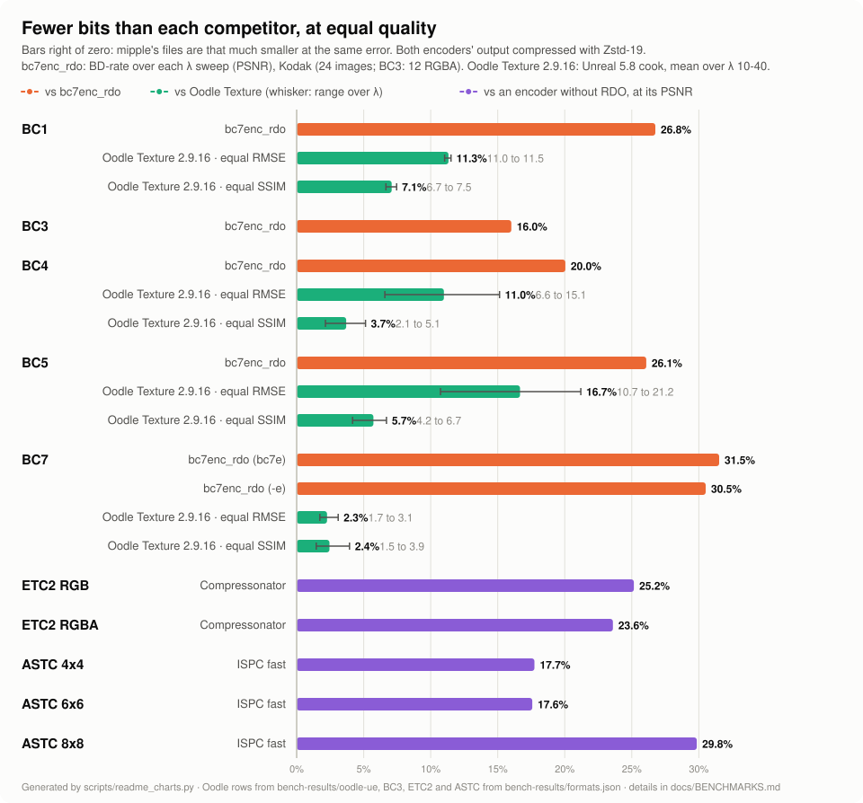
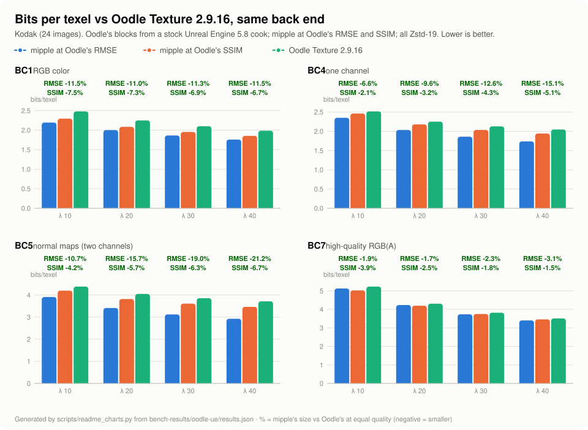
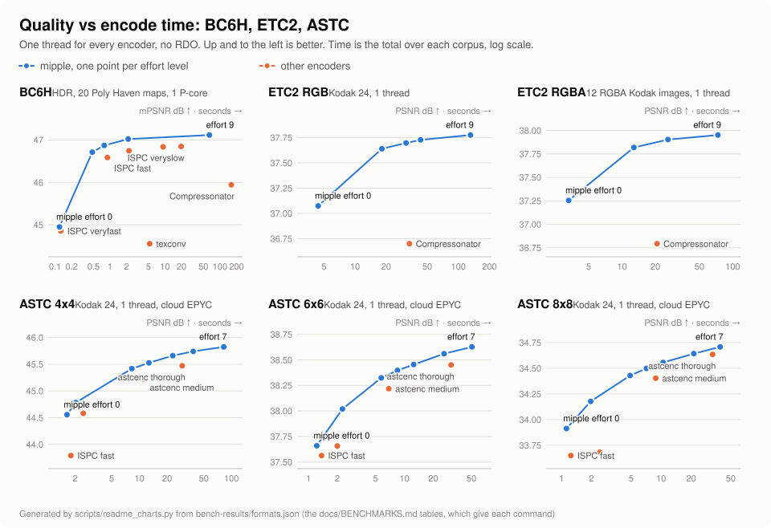
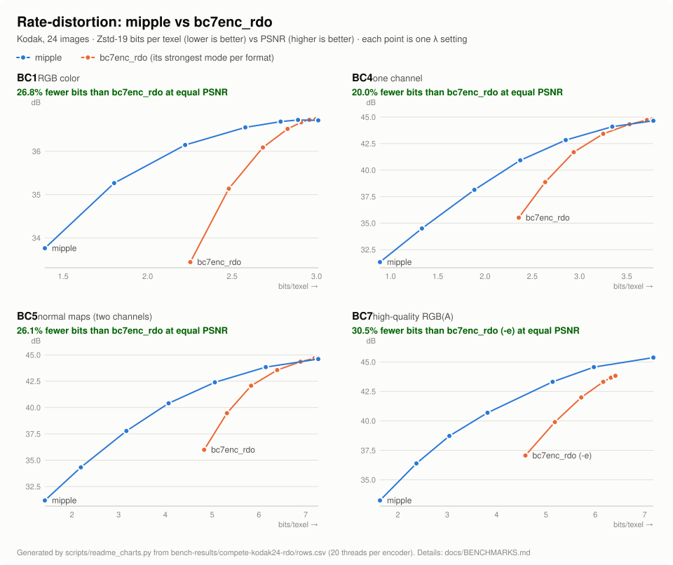
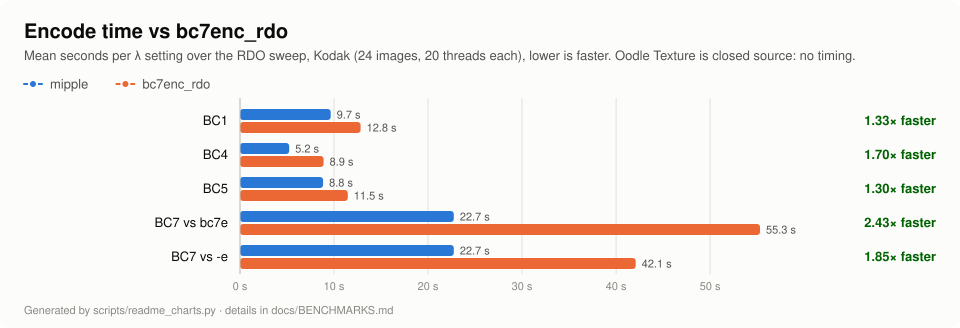

#  mipple

[](https://www.rust-lang.org)
[](LICENSE)

A rate-distortion optimized GPU texture encoder in Rust. It writes standard **BC1 / BC3 / BC4 / BC5 / BC7**
blocks, tuned so Zstd or Deflate shrink them further, plus **BC6H** for HDR and **ETC2 / EAC** and **ASTC**
(4x4, 6x6, 8x8) for mobile.
Output goes to **KTX2** with optional Zstd supercompression. GPUs read it directly; nothing new runs at load
time.


What RDO does, measured on Kodak 23 at λ = 1. Cyan blocks became exact copies of an earlier
block, and magenta blocks were re-encoded to share a run of bytes with one. Detailed blocks such as
the eye are kept as encoded. The loupe shows the decoder's exact pixels and links each block to the
one it reuses. Regenerate with `python scripts/rdo_anim.py`.

**[Try it in your browser](https://azazel-labs.github.io/Mipple/)**: drop in your own image, move the
quality and size sliders, and zoom in to compare pixels against the source. The encoder runs as
WebAssembly on your machine; your images never leave the browser.

Version 0.9. Background research: [docs/reference/oodle-rdo-ktx2.md](docs/reference/oodle-rdo-ktx2.md);
notes on Binomial's bc7f/bc7g encoders: [docs/research/bc7f-bc7g.md](docs/research/bc7f-bc7g.md).

## Results so far

<!-- results:start -->
<!-- Generated by scripts/readme_charts.py; edit that script, not this block. -->











**bc7enc_rdo:** RDO on all 24 Kodak images, 20 threads per encoder, graded identically with `mipple score`. BD-rate is the size difference at equal PSNR (negative = mipple is smaller); times are the range over each encoder's λ sweep. **Oodle Texture 2.9.16** is closed source, so it is run the way a game team runs it: a stock Unreal Engine 5.8 install imports the same Kodak images and cooks them (RDO on, Lossy Compression Amount Low to Highest = Oodle λ 10-40), and Oodle's blocks are taken from the cook and compressed with Zstd-19 like mipple's. mipple's size is measured at Oodle's RMSE and at its SSIM (positive = mipple is larger); there is no timing, since Unreal builds textures in parallel. Every caveat is in [docs/BENCHMARKS.md](docs/BENCHMARKS.md).

| Format | vs | Zstd-19 | Deflate-9 | mipple time (s) | competitor time (s) |
| --- | --- | --- | --- | --- | --- |
| BC1 | bc7enc_rdo | **−26.8%** | **−23.9%** | 7.8-11.7 | 11.9-13.3 |
| BC1 | Oodle Texture 2.9.16 (Unreal 5.8), equal RMSE | **−11.5%** to **−11.0%** (λ 10-40) | n/a | n/a | n/a |
| BC1 | Oodle Texture 2.9.16 (Unreal 5.8), equal SSIM | **−7.5%** to **−6.7%** (λ 10-40) | n/a | n/a | n/a |
| BC4 | bc7enc_rdo | **−20.0%** | **−18.4%** | 4.1-5.9 | 8.3-9.4 |
| BC4 | Oodle Texture 2.9.16 (Unreal 5.8), equal RMSE | **−15.1%** to **−6.6%** (λ 10-40) | n/a | n/a | n/a |
| BC4 | Oodle Texture 2.9.16 (Unreal 5.8), equal SSIM | **−5.1%** to **−2.1%** (λ 10-40) | n/a | n/a | n/a |
| BC5 | bc7enc_rdo | **−26.1%** | **−23.8%** | 6.6-9.8 | 10.8-12.3 |
| BC5 | Oodle Texture 2.9.16 (Unreal 5.8), equal RMSE | **−21.2%** to **−10.7%** (λ 10-40) | n/a | n/a | n/a |
| BC5 | Oodle Texture 2.9.16 (Unreal 5.8), equal SSIM | **−6.7%** to **−4.2%** (λ 10-40) | n/a | n/a | n/a |
| BC7 | bc7enc_rdo (bc7e) | **−31.5%** | **−29.2%** | 17.1-28.5 | 51.8-57.8 |
| BC7 | bc7enc_rdo (-e) | **−30.5%** | **−28.6%** | 17.1-28.5 | 38.1-44.4 |
| BC7 | Oodle Texture 2.9.16 (Unreal 5.8), equal RMSE | **−3.2%** to **−1.7%** (λ 10-40) | n/a | n/a | n/a |
| BC7 | Oodle Texture 2.9.16 (Unreal 5.8), equal SSIM | **−3.9%** to **−2.0%** (λ 10-40) | n/a | n/a | n/a |
| BC3 | bc7enc_rdo | **−16.0%** | **−14.4%** | n/a | n/a |
| ETC2 RGB | Compressonator | **−25.2%** | **−24.6%** | n/a | n/a |
| ETC2 RGBA | Compressonator | **−23.6%** | **−24.1%** | n/a | n/a |
| ASTC 4x4 | ISPC fast | **−17.7%** | **−17.1%** | n/a | n/a |
| ASTC 6x6 | ISPC fast | **−17.6%** | **−17.0%** | n/a | n/a |
| ASTC 8x8 | ISPC fast | **−29.8%** | **−29.2%** | n/a | n/a |

Refresh after a new benchmark run with `python scripts/readme_charts.py` (reads `bench-results/compete-kodak24-rdo/rows.csv` and `bench-results/oodle-ue/results.json`, rewrites this block and `docs/img/*.svg`).

<!-- results:end -->

## Quick start

Prebuilt binaries for Linux, Windows and macOS are on the
[releases page](https://github.com/Azazel-Labs/mipple/releases): one `vX.Y.Z` release for every main commit that
passes CI. To build from source you need Rust 1.90+ (stable).

```sh
cargo build --release
cargo test --release                       # incl. cross-checks against independent decoders
cargo xtask ci                             # what CI runs: fmt --check, clippy -D warnings, tests

./target/release/mipple synth -o test-images/synthetic
./target/release/mipple encode test-images/synthetic/albedo_bricks.png -o bricks.ktx2 -f bc7 -l 1
./target/release/mipple info bricks.ktx2
./target/release/mipple decode bricks.ktx2 -o bricks.decoded.png
./target/release/mipple compare test-images/synthetic/albedo_bricks.png bricks.decoded.png
./target/release/mipple bench test-images/synthetic -f bc1,bc4,bc5,bc7 -l 0,0.5,1,2,4 --csv out.csv
./target/release/mipple check              # ~30 s regression check vs bench-results/check-baseline.csv
```

## Checking for regressions

`mipple check` is the quick safety net to run after any encoder change, instead of the full benchmark or
head-to-head. It encodes the built-in synthetic set (six 256² images, all four formats, λ 0/0.5/1/2/4) in about
30 seconds on two cores, compares with the committed baseline, and exits non-zero if any format:

- loses more than **1% BD-rate** (size at equal PSNR, Zstd-19) against the baseline curve;
- at **λ = 0**, drops more than **0.1 dB** pooled PSNR or grows more than **1%** in Zstd size;
- at **λ = 0**, drops more than **0.5 dB** on any single image.

It also reports how many encodes are byte-identical to the baseline, so a pure refactor shows "120/120".
Timing is shown, but only gated with `--max-slowdown` (timings vary by machine). All thresholds are flags.

```sh
mipple check                                          # synthetic corpus
mipple check --corpus test-images/kodak --limit 4 -f bc7   # real photos, ~35 s, baseline check-baseline-kodak.csv
mipple check --update-baseline                        # accept the current output as the new baseline
```

When a change is meant to move the numbers, run the check, read the table, and if the trade is the one you
wanted, re-run with `--update-baseline` and commit the new CSV with the change. CI runs `mipple check` on Linux.

Normal maps: `-f bc5 --normal`. Masks: `-f bc4`. Data maps are linear by default; BC1/BC7 default to sRGB
(`--linear` / `--srgb` override).

## Opening in VS Code

Open the folder and accept the recommended extensions (rust-analyzer, CodeLLDB, Even Better TOML, Dependi).

- **Build / test:** `Ctrl+Shift+B` builds release; *Run Test Task* runs the suite. rust-analyzer checks with clippy on save.
- **Tasks** (*Terminal → Run Task*): regression check (synthetic, Kodak first 4, accept baseline), generate synthetic images, bench synthetic, bench Kodak, compete vs bc7enc_rdo and the bcn_harness encoders, encode the image open in the editor, decode the open KTX2.
- **Debug** (F5): encode bricks, encode the current image, bench, unit tests, and the cross-decode integration test, all under CodeLLDB.

## Commands

| Command | What it does |
| --- | --- |
| `encode IN -o OUT.ktx2\|OUT.dds\|OUT.astc [-f bc7] [-e 0-9] [-l λ] [--entropy off\|on\|auto] [--normal] [--no-mips] [--alpha auto\|transparency\|data] [--alpha-cutoff C] [--zstd N]` | Encode with mips, optional RDO; KTX2 (Zstd level N, 0 = raw), DDS or `.astc` (one level) by extension (ETC2/EAC: KTX2 only; ASTC: KTX2 or `.astc`) |
| `decode IN.ktx2\|IN.dds\|IN.astc -o OUT.png [--level N] [--normal] [--astc-linear]` | Decode one mip level (a `.astc` file records no sRGB flag: it decodes as sRGB unless `--astc-linear`) |
| `info IN.ktx2\|IN.astc` | Header, per-level offsets and sizes, key/value data |
| `compare A B [--normal]` | PSNR (RGB, per channel, luma), SSIM, normal angular error |
| `bench PATHS… [-f …] [-l …] [--csv] [--markdown]` | Size-vs-quality sweep across a corpus |
| `check [--corpus DIR --limit N] [--update-baseline]` | Fast regression check against a stored baseline; non-zero exit on regression |
| `score SRC.png ENC.dds\|ENC.ktx2\|ENC.astc [--csv --label L --secs T]` | Grade *any* encoder's output with mipple's metrics and back ends |
| `synth [-o DIR]` | Write the procedural test set |
| `gpu` | The GPU adapter, what it supports, and which formats it base-encodes |

RDO knobs (on `encode`, `bench` and `check`): `--window`, `--max-back`, `--span-back`, `--chunk-bytes`, `--defer`, `--smooth-scale`, `--smooth-std`, `--smooth-window-std`,
`--max-rms-ratio`, `--min-rms`.

**Alpha.** For BC7 colour textures alpha is transparency by default (`--alpha data` turns it off). The colour left under
alpha-0 texels is replaced by a push-pull bleed of the visible colour around it, and mips average RGB weighted by alpha,
so cutout edges get no dark or coloured fringes at a distance. Texels more than 2 texels from a visible one cost no bits:
blocks that are hidden throughout become identical constant blocks. On a 1024² foliage cutout with busy colour under its
mask (`synth::cutout`), files are 54% smaller without RDO and 72-78% smaller at λ 1-4, and encoding is 2-4× faster.
`--alpha-cutoff 0.5` keeps each mip's alpha-test coverage equal to the top level's, so foliage and fences don't thin out.
GPU compute encoders (wgpu) write exactly the CPU encoder's blocks, so the backend only changes speed. By default
each format runs wherever it is faster (`mipple gpu` lists them); `--gpu` forces the GPU for every format that has
a kernel and `--cpu` forces the CPU. BC4/BC5 (every effort), BC1 (efforts 0-1) and BC7 (efforts 0-5) have GPU kernels, but the
AVX2 encoder is faster at a few ms per megapixel. In the web demo, where the CPU is one wasm thread, the same kernels run on
WebGPU and win (BC7 effort 5: 42 vs 902 ms for a 512² mip chain in Chrome). Cargo features: `cli` (the `mipple` binary) and `gpu` (wgpu), both on by default;
`default-features = false` builds the library alone.
`--entropy` picks BC7 entropy-reduced base encoding: `auto` (default: on for λ ≥ 1), `on`, or `off` (v0.2 behaviour).

## What's inside

- BC1, BC3, BC4, BC5 and BC7 encoders (all 8 BC7 modes), with an entropy-reduced BC7 mode for RDO (mode-6
  preference, 64-level mode-6 endpoints), and wgpu compute kernels that write the CPU's exact blocks (BC3
  is CPU only for now).
- A BC6H encoder (unsigned half floats, all 14 modes) that reads Radiance `.hdr` and is scored with mPSNR
  and log2 RMSE in linear light; `scripts/compete_bc6h.py` grades it against ISPC, texconv and
  Compressonator. `--lambda` runs an RDO pass for it with a log-space distortion (about 42% smaller Zstd
  files at λ 2). No GPU kernel for it yet.
- ETC2 RGB (individual, differential, T, H and planar modes), ETC2 RGBA8, and EAC R11 / RG11 (unsigned)
  encoders and decoders, KTX2 only, with the same RDO pass; `scripts/compete_etc.py` grades them against
  Compressonator. CPU only.
- ASTC LDR 4x4, 6x6 and 8x8 (1-3 partitions, dual plane, every weight grid of the footprint) encoders and
  a decoder for every 2D footprint, to KTX2 or `.astc`, encoded for sRGB or linear decoding;
  `scripts/compete_astc.py` grades them against Intel ISPC and Arm's astcenc (on the 24 Kodak images, effort 0
  beats ISPC fast in PSNR and SSIM in less time, and some effort beats each astcenc preset, fast to thorough,
  in PSNR and SSIM in less time, at all three footprints). CPU only; its RDO pass reads the surface itself (blocks are
  not 4x4).
- An RDO pass shared by all formats, with an LZ rate model, smooth-block protection, a per-block error cap,
  and a real-Zstd check that reverts any chunk RDO didn't shrink.
- A KTX2 writer and reader with a DFD byte-identical to the `ktx2` crate's.
- `mipple check`, a 30-second regression check with BD-rate gates against a committed baseline (also in CI).
- A benchmark harness, a synthetic corpus, DDS I/O, and a competitor driver (`scripts/compete.py`) that grades
  mipple, bc7enc_rdo/bc7e, bc7f, Intel ISPC, icbc, stb_dxt, Compressonator and texconv with the same metrics
  and reports BD-rate; `scripts/ue_oodle/` does the same against Oodle Texture through Unreal Engine.

Design details are in [docs/ARCHITECTURE.md](docs/ARCHITECTURE.md); next steps are in [docs/ROADMAP.md](docs/ROADMAP.md).

## Layout

```text
src/            library + CLI (see docs/ARCHITECTURE.md for the module map)
tests/          cross-decoder, KTX2 container and quality/RDO tests
docs/           architecture, benchmarks, roadmap, research notes (docs/research/)
bench-results/  check baselines and the compete / Oodle runs behind docs/BENCHMARKS.md
test-images/    synthetic set (generated); Kodak is fetched by scripts/, not committed
scripts/        corpus fetchers, compete.py / scoreboard.py (vs competitors), ue_oodle/ (vs Oodle),
                readme_charts.py, ranker training (train_ranker*.py), make_icon.py
tools/          competitors/: bcn_harness, third-party BCn encoders behind one CLI
web/            the browser demo (wasm)
.vscode/        settings, tasks, launch configs, extension recommendations
```

## Notes

- BC7 partition tables were cross-checked against `texture2ddecoder` (MIT OR Apache-2.0); tests decode our output with it.

## License

[MIT No Attribution](LICENSE) (MIT-0), copyright Azazel Labs LLC. Use, copy, modify and redistribute freely; no
attribution required. The sample textures in `web/www/samples` are CC0 from Poly Haven (`CREDITS.txt`).
